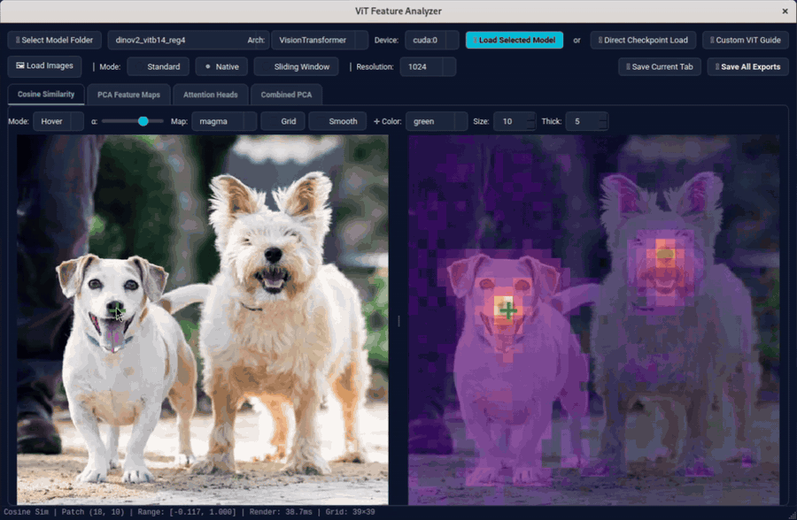
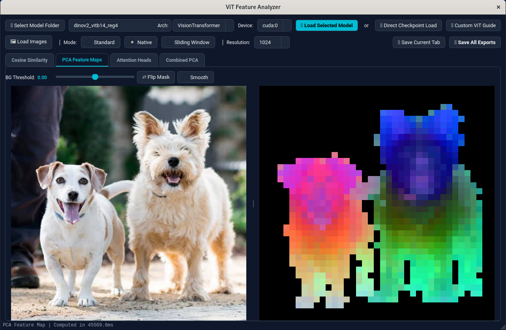

# ViT Feature Analyzer

**ViT Feature Analyzer** is an interactive PyQt5 desktop application for inspecting, comparing, and exporting dense visual representations learned by Vision Transformers (ViTs).

Point the analyzer at any saved Vision Transformer checkpoint (`.pth`, `.pt`, `.bin`, or `.safetensors`) to interactively explore patch-level cosine similarities, foreground-isolated PCA feature maps, multi-image joint PCA projections, and per-head self-attention maps across arbitrary image resolutions.

<div align="center">

### 🎯 Interactive Patch-to-Patch Cosine Similarity
*Hover or click across any image patch to visualize dense semantic similarity heatmaps in real time (~120 FPS).*

<a href="assets/cosine-sim.mov">
  
</a>
<br/>
<sub><a href="assets/cosine-sim.mov">🎬 Click to view full-resolution video (<code>assets/cosine-sim.mov</code>)</a></sub>

<br/><br/>

### 🎨 Foreground-Aware SVD PCA Feature Maps
*Isolate foreground objects via 1st Principal Component (PC1) thresholding and project patch tokens into a 3D RGB PCA basis.*



</div>

---

## ✨ Key Features

- **Universal ViT Checkpoint Loading**
  - **Built-in Positional Embeddings**: Out-of-the-box support for **Rotary Position Embeddings (`rope`)** (DINOv3, EVA-02), **Learnable Positional Embeddings (`learnable`)** with dynamic 2D bicubic interpolation (original ViT, DeiT, DINOv1/v2, MAE, I-JEPA, `timm`), and **2D Sinusoidal Positional Embeddings (`sinusoidal`)** (original ViT / MAE / MoCo-v3).
  - **Automatic Hyperparameter Inference**: Load raw `.pth`/`.pt` checkpoints even without a configuration file—the analyzer inspects tensor shapes in the `state_dict` (`embed_dim`, `depth`, `patch_size`, `num_heads`, `pos_embed_type`, `ffn_layer`, `norm_layer`, `n_storage_tokens`, LayerScale, etc.) to initialize the model automatically.
  - **Interactive Configuration & Retry Loop**: Choose between **Auto-Infer**, **Manual Parameter Entry**, or **YAML/JSON Config Files**. If a checkpoint fails to load due to a hyperparameter mismatch, an interactive configuration dialog opens pre-populated with inferred values and exact error diagnostics until the model loads cleanly.
  - **Smart Checkpoint Unwrapping**: Automatically unwraps nested checkpoint dictionaries (`model_state_dict`, `state_dict`, `model`, `teacher`, `student`, `encoder`, `x_encoder`, `backbone`) and strips DDP/compiler prefixes (`module.`, `_orig_mod.`, `backbone.`, `x_encoder.`).

- **3 Flexible Inference Modes**
  - **Standard Mode**: Resizes images to the model's training resolution (`img_size × img_size`) for a single forward pass.
  - **Native Resolution Mode**: Preserves original image aspect ratio and resolution (or caps at `224`, `512`, `768`, `1024`), dynamically interpolating positional embeddings to match the exact `(H, W)` patch grid.
  - **Sliding Window Mode**: Extracts overlapping `img_size × img_size` crops (`stride = img_size // 2`) and averages stitched patch tokens to produce high-resolution dense feature maps.

- **4 Interactive Analysis Views**
  1. **Cosine Similarity**: Hover or click on any image patch `(row, col)` to compute and render real-time (~120 FPS) cosine similarity heatmaps between the query patch token and all other patches. Includes adjustable alpha blending, 8 colormaps (`magma`, `viridis`, `inferno`, `plasma`, `cividis`, `hot`, `jet`, `coolwarm`), patch grid overlay, bilinear smoothing, and customizable crosshairs.
  2. **PCA Feature Maps**: Computes exact SVD-based Principal Component Analysis over L2-normalized patch tokens. Uses the 1st principal component (`PC1`) with an interactive background threshold slider (`[-1.0, 1.0]`) and mask-inversion toggle (`⇄ Flip Mask`) to isolate foreground objects, then re-fits 3-component PCA on the foreground tokens mapped to RGB.
  3. **Attention Heads**: Hooks into the last transformer block's self-attention layer and renders a multi-panel grid showing the original image, aggregate attention (sum across heads), average CLS token attention, and every individual attention head.
  4. **Combined PCA (Multi-Image Joint Basis)**: Concatenates foreground patch tokens across multiple loaded images (grouped either as `"All Same Class"` or `"Split by Filename"` prefix before `-`) and computes a shared 3D PCA basis so semantically similar object parts share consistent RGB colors across different images.

- **Publication-Quality Exports**
  - Export the active visualization tab directly to PNG (`💾 Save Current Tab`), or export a complete bundle (`💾 Save All Exports`) containing the original image, cosine similarity overlay + raw heatmap PNGs, single-image PCA PNG + vector PDF (`300 DPI`), attention head grid PNG + PDF, and combined PCA maps.

---

## 🚀 Installation & Quickstart

### Prerequisites
- Python **3.11+**
- PyTorch & Torchvision (CPU or CUDA)

### Option 1: Using `uv` (Recommended)
```bash
git clone https://github.com/AaratSatsangi/vit-feature-analyzer
cd vit-feature-analyzer
uv sync
uv run python -m app
```

### Option 2: Using `pip`
```bash
git clone https://github.com/AaratSatsangi/vit-feature-analyzer
cd vit-feature-analyzer
pip install -e .
python -m app
```

---

## 📂 Loading Models & Configurations

### 1. Loading a Checkpoint
You can load models in two ways from the top toolbar:
- **📁 Select Model Folder**: Recursively scans a directory for `.pth`, `.pt`, `.bin`, and `.safetensors` checkpoints and populates the model dropdown.
- **📂 Direct Checkpoint Load**: Browse and open any single checkpoint file directly.

### 2. Configuration Modes
When you load a checkpoint:
1. **Companion Config Auto-Detection**: If a YAML or JSON config file is located next to the checkpoint (e.g., `<checkpoint_name>.yaml`, `config.yaml`, or `../config/<checkpoint_name>_config.yaml`), it is parsed automatically. Flat configs, nested configs (`encoder_config`, `model`, `backbone`), and WandB `config.yaml` files are all supported.
2. **Interactive Prompt (When No Config File Is Found)**:
   - **✨ Auto-Infer Configuration from Checkpoint**: Inspects the checkpoint's `state_dict` tensors to automatically determine `embed_dim`, `depth`, `patch_size`, `img_size`, `num_heads`, `pos_embed_type` (`rope` vs `learnable`), `ffn_layer` (`mlp` vs `swiglu`), `norm_layer` (`layernorm` vs `rmsnorm`), `n_storage_tokens`, biases, and LayerScale.
   - **⚙️ Enter / Review Model Parameters Manually**: Opens the **ViT Model Configuration** dialog pre-filled with inferred defaults so you can customize any parameter before loading.
   - **📂 Load Existing YAML / JSON Config File**: Browse for a configuration file anywhere on disk.
3. **Fault-Tolerant Retry Loop**: If auto-inference or manual parameters fail to load the checkpoint weights, the configuration dialog re-opens with the exact PyTorch error trace so you can tweak the parameters (or export the working settings to a `.yaml` file for future use) until loading succeeds.

### Example YAML Configuration
```yaml
model_class: VisionTransformer
pos_embed_type: learnable   # Options: rope, learnable, sinusoidal, none
img_size: 224
patch_size: 16
in_chans: 3
embed_dim: 768
depth: 12
num_heads: 12
ffn_layer: mlp              # Options: mlp, swiglu, swiglu32, swiglu64, swiglu128
ffn_ratio: 4.0
norm_layer: layernorm       # Options: layernorm, layernormbf16, rmsnorm
use_cls_token: true
n_storage_tokens: 0
qkv_bias: true
proj_bias: true
ffn_bias: true
patch_embed_norm: false
layerscale_init: null       # Set to e.g. 1.0e-5 if checkpoint uses LayerScale (ls1/ls2)
```

---

## 🛠️ Developer Guide: Adding a Custom ViT Architecture

If you have a custom Vision Transformer architecture whose layer structure or forward pass differs from the standard built-in `VisionTransformer`, **ViT Feature Analyzer** provides a plugin system via `models/base.py`.

You can also view this guide directly inside the app by clicking **📘 Custom ViT Guide** in the top-right toolbar.

### Step 1: Create a Model File in `models/`
Create a new Python file in the `models/` directory (for example, `models/my_custom_vit.py`). Any class that inherits from `BaseViT` inside `models/*.py` is **automatically discovered** on startup and added to the **Arch** dropdown!

### Step 2: Implement the `BaseViT` Interface

Your subclass only needs to implement `forward_features(self, x: Tensor)` (and optionally `get_attention_map` and `infer_config_from_state_dict`):

```python
import torch
from torch import Tensor, nn
from typing import Any, Dict, Optional, Union
from models.base import BaseViT


class MyCustomViT(BaseViT):
    def __init__(
        self,
        img_size: int = 224,
        patch_size: int = 16,
        embed_dim: int = 768,
        depth: int = 12,
        num_heads: int = 12,
        use_cls_token: bool = True,
        n_storage_tokens: int = 0,
        **kwargs,
    ):
        super().__init__()
        # Store metadata attributes used by BaseViT.get_model_metadata()
        self.img_size = img_size
        self.patch_size = patch_size
        self.embed_dim = embed_dim
        self.num_heads = num_heads
        self.use_cls_token = use_cls_token
        self.n_storage_tokens = n_storage_tokens

        # Define your custom layers here
        # self.patch_embed = ...
        # self.blocks = ...
        # self.norm = ...

    def forward_features(self, x: Tensor) -> Union[Dict[str, Tensor], Tensor]:
        """
        REQUIRED.
        Args:
            x: Normalized image tensor of shape [B, C, H, W].
        Returns:
            Either:
            - A Tensor of spatial patch tokens with shape [B, N_patches, D]
              (where N_patches = (H // patch_size) * (W // patch_size)), OR
            - A dict {"x_norm_patchtokens": patch_tokens}
        """
        # Example:
        # tokens = self.forward_backbone(x)
        # patch_tokens = tokens[:, 1 + self.n_storage_tokens :, :]
        # return {"x_norm_patchtokens": patch_tokens}
        raise NotImplementedError

    def get_attention_map(self, x: Tensor, layer_num: int = -1) -> Optional[Tensor]:
        """
        OPTIONAL (enables the 'Attention Heads' tab).
        Args:
            x: Normalized image tensor of shape [B, C, H, W].
            layer_num: Block index (-1 for the last block).
        Returns:
            Post-softmax attention weights of shape:
            - [B, num_heads, Seq, Seq] (full token attention matrix), OR
            - [B, num_heads, H_feat, W_feat] (pre-extracted CLS-to-patch attention),
            or None if attention visualization is not needed.
        """
        return None

    @classmethod
    def infer_config_from_state_dict(cls, state_dict: Dict[str, Tensor]) -> Dict[str, Any]:
        """
        OPTIONAL.
        Inspect `state_dict` tensors and return a dict of `__init__` kwargs
        to support one-click Auto-Infer when loading without a YAML file.
        """
        return {}
```

### Required & Optional Methods Summary

| Method | Status | Input | Expected Output |
| :--- | :--- | :--- | :--- |
| `forward_features(self, x)` | **Required** | `x: Tensor [B, C, H, W]` | `Tensor [B, N_patches, D]` or `{"x_norm_patchtokens": Tensor [B, N_patches, D]}` |
| `get_attention_map(self, x, layer_num=-1)` | *Optional* | `x: Tensor [B, C, H, W]` | `Tensor [B, num_heads, Seq, Seq]` or `Tensor [B, num_heads, H_feat, W_feat]` or `None` |
| `get_model_metadata(self)` | *Optional* | None | `{"img_size": int, "patch_size": int, "num_heads": int, "n_storage": int, "use_cls": bool}` (auto-populated if attributes are set on `self`) |
| `infer_config_from_state_dict(cls, state_dict)` | *Optional* | `state_dict: Dict[str, Tensor]` | `Dict[str, Any]` of keyword arguments for `__init__` |

---

## 🗂️ Project Structure

```text
├── app/
│   ├── __main__.py              # Application entry point (`python -m app`)
│   ├── main_window.py           # Main studio window, toolbars, and export orchestration
│   ├── model_loader.py          # Checkpoint discovery, state_dict inference, and interactive loader
│   ├── inference.py             # Standard, Native, and Sliding Window feature/attention extraction
│   ├── style.py                 # Dark Fusion theme and QSS stylesheet
│   ├── tabs/
│   │   ├── cosine_tab.py        # Interactive patch-to-patch cosine similarity viewer
│   │   ├── pca_tab.py           # Single-image SVD PCA with PC1 background thresholding
│   │   ├── attention_tab.py     # Multi-head CLS attention grid viewer
│   │   └── combined_pca_tab.py  # Multi-image joint PCA projection viewer
│   ├── utils/
│   │   ├── pca.py               # SVD PCA & foreground re-fitting algorithms
│   │   ├── attention.py         # Matplotlib headless attention grid renderer
│   │   ├── colormaps.py         # Colormap mapping utilities
│   │   └── export.py            # PNG & publication-ready PDF export helpers
│   └── widgets/
│       ├── config_dialog.py     # Interactive model configuration & Custom ViT Guide dialogs
│       ├── image_panel.py       # Interactive QPainter canvas with heatmap & crosshair overlay
│       ├── drop_zone.py         # Drag-and-drop image loader widget
│       └── thumbnail_strip.py   # Multi-image horizontal thumbnail selector
├── models/
│   ├── __init__.py              # Dynamic BaseViT subclass auto-discovery registry
│   ├── base.py                  # BaseViT abstract interface for custom ViT plugins
│   ├── vision_transformer.py    # Built-in ViT supporting RoPE, Learnable, and Sinusoidal pos_embed
│   └── layers/                  # Self-attention, SwiGLU/MLP, PatchEmbed, RMSNorm, LayerScale, RoPE
└── pyproject.toml
```

---

## 📖 Citation

If you find **ViT Feature Analyzer** useful in your research or work, please cite it using the following BibTeX entry:

```bibtex
@software{satsangi2026vitfeatureanalyzer,
  author       = {Satsangi, A.},
  title        = {{ViT Feature Analyzer: Interactive Visualization and Analysis Studio for Vision Transformers}},
  year         = {2026},
  url          = {https://github.com/AaratSatsangi/vit-feature-analyzer}
}
```
